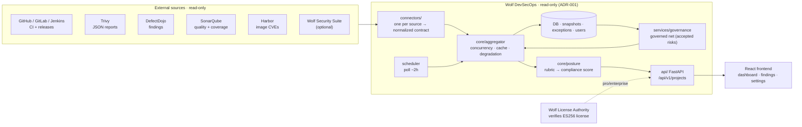

<div align="center">

# 🐺 Wolf DevSecOps

**One panel for all your code security.**

*Community Edition · by Wolf Industries · Apache-2.0*

[Español](README.md) · **English**

</div>

---

Wolf DevSecOps is an open-source **aggregator console**: it brings the security and
quality status of your projects into a single dashboard, reading what your tools
already produce —**GitHub Actions**, **SonarQube**, **DefectDojo**, **Trivy** and
**Harbor**— without replacing them. The panel never scans on its own (ADR-001);
the all-in-one installer *can* run **Trivy** as a convenience to give you a first
score on day one. A *single pane of glass*.

It isn't tied to any project: you point Wolf DevSecOps at **your** repos and
**your** sources through a config file, and that's it. Designed so any team can
drop it into its own pipeline with a `docker compose up`.

## Quick install

One assisted command brings up the whole suite (panel + SonarQube + DefectDojo +
Trivy).

```bash
git clone https://github.com/FireWolfCL/wolf-devsecops.git
cd wolf-devsecops
bash deploy/install.sh --lang en     # Windows: pwsh deploy/install.ps1 -Lang en
```

→ Full guide (ES + EN): **[INSTALL.md](INSTALL.md)** · Kubernetes: [`deploy/DEPLOY.md`](deploy/DEPLOY.md)
→ On your own for security? **[First 30 days](docs/PRIMEROS-30-DIAS.md)** · Operations and backups: [docs/RUNBOOK.md](docs/RUNBOOK.md)

## What does it show?

For each project you configure:

- **CI status** — did the last run's gates pass? (GitHub Actions)
- **Vulnerabilities** — dependency CVEs, SAST, config, secrets (DefectDojo)
- **Quality** — bugs, code smells, coverage (SonarQube)
- **Containers** — CVEs in the images you're about to deploy (**Harbor** + trivy-adapter as the production path; standalone Trivy as the no-registry fallback — see [INSTALL.md](INSTALL.md))
- **Releases** — latest published version and its SBOM
- **Remediation** — open PRs that propose fixes

Findings are grouped by scan type (secrets · SAST · SCA · container · IaC · DAST).
To feed them from **your** CI → DefectDojo there are ready-made pipelines: see
**[docs/PIPELINES.md](docs/PIPELINES.md)** and [`deploy/ci-examples/`](deploy/ci-examples/).

## Screenshots

<div align="center">

<sub>📸 Screenshots coming soon — Dashboard · Project detail · Findings · Settings (sample data, project names anonymized).</sub>

</div>

## Architecture

**How the system connects** — the panel is *read-only* (ADR-001): it reads what
your tools already produce, normalizes it to a common contract and scores it. It
never writes back to the sources.



The backend exists so **tokens live on the server**, never in the browser. It
normalizes the sources into a common format and caches them.

### Layers

| Layer | Responsibility |
|---|---|
| **Frontend** (React) | Dashboard, findings and settings. Never sees the tokens. |
| **API** (FastAPI) | Translates HTTP ⇄ aggregator; keeps tokens on the server. |
| **Aggregator** (`core/aggregator`) | Calls connectors in parallel, applies cache and degradation, bakes the governed net and the score. |
| **Connectors** (`connectors/`) | One per source; translate each external API into the normalized contract. Read-only. |
| **Scheduler** | Periodic poll (~2h) → stores a posture *snapshot* in the DB. |
| **DB** | Posture snapshots, exceptions (accepted risks) and users. |
| **WLA** | Verifies the signed (ES256) license that unlocks Pro/Enterprise. |

→ Full architecture (modules, contracts, ADRs): **[docs/ARCHITECTURE.md](docs/ARCHITECTURE.md)**

## Stack

- **Backend:** Python 3.12 · FastAPI
- **Frontend:** React 18 · Vite · TypeScript
- **Deployment:** Docker Compose

## Part of the Wolf ecosystem

Wolf DevSecOps Community runs **on its own**, with no other Wolf dependency. When
you also use **Wolf Security Suite (WSS)** —Wolf Industries' GRC/vCISO platform—,
Wolf DevSecOps integrates with it and adds **infrastructure and asset**
vulnerabilities to the code view. WSS is an **optional** integration: without it,
Wolf DevSecOps works just the same.

## License

Apache License 2.0 — see [LICENSE](LICENSE) and [NOTICE](NOTICE).
