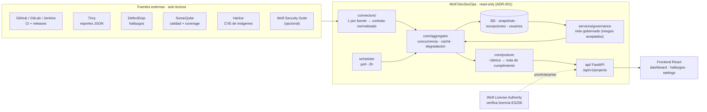
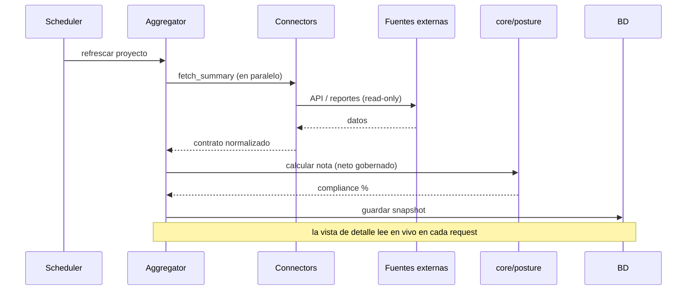

<div align="center">

# 🐺 Wolf DevSecOps

**Un solo panel para toda tu seguridad de código.**

*Community Edition · by Wolf Industries · Apache-2.0*

**Español** · [English](README.en.md)

</div>

---

Wolf DevSecOps es una **consola agregadora** open-source: reúne en un único
dashboard el estado de seguridad y calidad de tus proyectos, leyendo lo que ya
producen tus herramientas —**GitHub Actions**, **SonarQube**, **DefectDojo**,
**Trivy** y **Harbor**— sin reemplazarlas. El panel nunca escanea por su cuenta
(ADR-001); el instalador todo-en-uno sí puede correr **Trivy** como conveniencia
para darte un primer puntaje el día uno. Un *single pane of glass*.

No está atada a ningún proyecto: apuntas Wolf DevSecOps a **tus** repos y **tus**
fuentes mediante un archivo de configuración, y listo. Pensada para que cualquier
equipo la integre en su propio pipeline con un `docker compose up`.

## Instalación rápida / Quick install

**ES:** Un solo comando asistido levanta toda la suite (panel + SonarQube +
DefectDojo + Trivy). **EN:** One assisted command brings up the whole suite.

```bash
git clone https://github.com/FireWolfCL/wolf-devsecops.git
cd wolf-devsecops
bash deploy/install.sh          # Windows: pwsh deploy/install.ps1
```

→ Guía completa (ES + EN): **[INSTALL.md](INSTALL.md)** · Kubernetes: [`deploy/DEPLOY.md`](deploy/DEPLOY.md)
→ ¿Estás solo a cargo de la seguridad? **[Primeros 30 días](docs/PRIMEROS-30-DIAS.md)** · Operación y backups: [docs/RUNBOOK.md](docs/RUNBOOK.md)

## ¿Qué muestra?

Por cada proyecto que configures:

- **Estado de CI** — ¿pasaron los gates del último run? (GitHub Actions)
- **Vulnerabilidades** — CVEs de dependencias, SAST, config, secretos (DefectDojo)
- **Calidad** — bugs, code smells, cobertura (SonarQube)
- **Contenedores** — CVEs de las imágenes que vas a desplegar (**Harbor** + trivy-adapter como camino productivo; Trivy suelto como fallback sin registry — ver [INSTALL.md](INSTALL.md))
- **Releases** — última versión publicada y su SBOM
- **Remediación** — PRs abiertos que proponen arreglos

Los Hallazgos se agrupan por tipo de escaneo (secrets · SAST · SCA · container ·
IaC · DAST). Para alimentarlos desde **tu** CI → DefectDojo hay pipelines listos:
ver **[docs/PIPELINES.md](docs/PIPELINES.md)** y [`deploy/ci-examples/`](deploy/ci-examples/).

## Capturas

<div align="center">

<sub>📸 Capturas en camino — Dashboard · Detalle de proyecto · Hallazgos · Settings (datos de ejemplo, proyectos anonimizados).</sub>

</div>

## Arquitectura

**Cómo se conecta el sistema** — el panel es *read-only* (ADR-001): lee lo que ya
producen tus herramientas, lo normaliza a un contrato común y lo puntúa. Nunca
escribe en las fuentes.



El backend es necesario para que los **tokens vivan en el servidor**, nunca en
el navegador. Normaliza las fuentes a un formato común y cachea.

### Capas

| Capa | Responsabilidad |
|---|---|
| **Frontend** (React) | Dashboard, hallazgos y settings. Nunca ve los tokens. |
| **API** (FastAPI) | Traduce HTTP ⇄ agregador; mantiene los tokens en el servidor. |
| **Aggregator** (`core/aggregator`) | Invoca los conectores en paralelo, aplica caché y degradación, hornea el neto gobernado y la nota. |
| **Connectors** (`connectors/`) | Uno por fuente; traducen cada API externa al contrato normalizado. Solo lectura. |
| **Scheduler** | Poll periódico (~2 h) → guarda un *snapshot* de postura en la BD. |
| **BD** | Snapshots de postura, excepciones (riesgos aceptados) y usuarios. |
| **WLA** | Verifica la licencia firmada (ES256) que habilita Pro/Enterprise. |

### Ciclo de un refresco



→ Arquitectura completa (módulos, contratos, ADRs): **[docs/ARCHITECTURE.md](docs/ARCHITECTURE.md)**

## Estado

**Community funcional.** Backend (FastAPI) + frontend (React) operativos;
conectores para GitHub, SonarQube, DefectDojo, Trivy y Harbor, más WSS opcional;
instalador asistido (`deploy/install.sh`) y rúbrica de postura
(`docs/POSTURE-RUBRIC.md`). Las ediciones Pro/Enterprise están en desarrollo.
Decisiones de diseño y arquitectura en `docs/`.

## Stack

- **Backend:** Python 3.12 · FastAPI
- **Frontend:** React 18 · Vite · TypeScript
- **Despliegue:** Docker Compose

## Parte del ecosistema Wolf

Wolf DevSecOps Community corre **por sí solo**, sin depender de nada más de Wolf.
Cuando además usas **Wolf Security Suite (WSS)** —la plataforma GRC/vCISO de Wolf
Industries—, Wolf DevSecOps se integra con ella y suma a la vista de código la de
vulnerabilidades de **infraestructura y activos**. WSS es una integración
**opcional**: si no la tienes, Wolf DevSecOps funciona igual.

## Licencia

Apache License 2.0 — ver [LICENSE](LICENSE) y [NOTICE](NOTICE).
